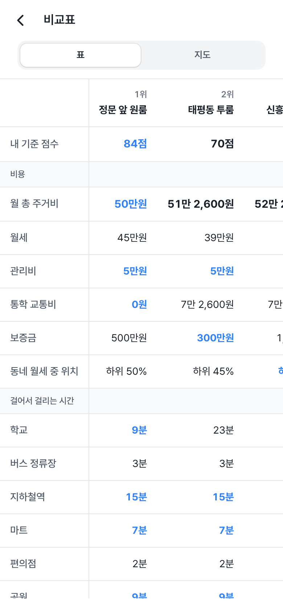
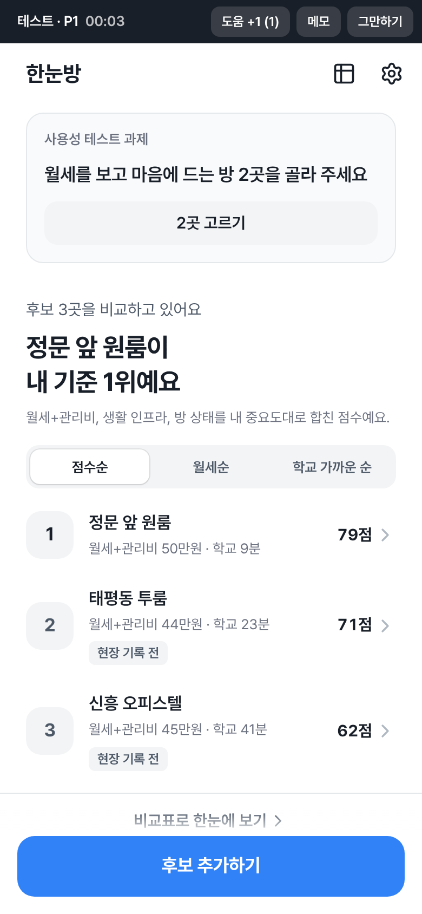

# 한눈방

자취방 후보를 한 표에서 비교하는 웹 서비스예요. 가천대학교 글로벌캠퍼스 주변에서 방을 구하는 학생이 여러 후보의 **월 총 주거비**, **생활 인프라까지 걸어서 걸리는 시간**, **집 보러 가서 기록한 방 상태**를 같은 기준으로 비교하고, 내가 정한 중요도로 순위를 확인해요.

창업프로젝트 「한눈방 프로젝트 계획 보고서」의 이번 학기 범위(비교표, 인프라 6개 항목 자동 계산, 월 총 주거비, 현장 체크리스트, 점수 정렬)를 구현했고, 사용성 테스트 모드와 백업, 동네 월세 시세를 더했어요.

| 처음 화면 | 홈(내 기준 순위) | 비교표 | 사용성 테스트 모드 |
| --- | --- | --- | --- |
|  |  |  |  |

## 기능

보고서 3장의 흐름 그대로예요.

1. **기준 정하기**: 처음 열면 월 총 주거비, 학교까지 거리, 버스 정류장, 지하철역, 마트, 편의점, 공원, 방 상태의 중요도를 4단계로 고르고 통학 정보(주 몇 일, 버스·지하철 요금)를 넣어요.
2. **후보 추가**: 주소나 건물 이름으로 검색하면 학교, 버스 정류장, 지하철역, 마트, 편의점, 공원까지 걸어서 몇 분인지 자동으로 계산해 표와 지도에 보여 줘요. 지도 연결 전에는 시간을 직접 넣어요.
3. **현장 기록**: 채광(창 방향), 환기(창 개수, 맞통풍), 수압, 곰팡이, 소음을 고르고 사진과 메모를 남겨요. 고칠 때마다 바로 저장돼요.
4. **비교와 결정**: 홈에서 점수순, 총 주거비순, 학교 가까운 순으로 보고, 비교표에서 항목마다 가장 좋은 값을 파란색으로 확인해요. 후보 상세에서는 점수가 어떻게 나왔는지 항목별로 보여 줘요.

**월 총 주거비** = 월세 + 관리비 + 통학 교통비(편도 요금 × 2 × 한 달 통학 일수). 학교까지 걸어서 15분(설정에서 바꿀 수 있음)이 넘으면 대중교통으로 다닌다고 보고 교통비를 더해요. 후보마다 '걸어서'나 '대중교통'으로 직접 바꿀 수도 있어요. 기본 요금은 교통카드 성인 기준 경기 시내버스 1,650원(2025.10.25 조정), 수도권 지하철 1,550원(2025.6.28 조정)이고, 환승 할인과 경기패스 환급은 넣지 않았어요.

### 더한 기능

- **사용성 테스트 모드**(설정 → 테스트 시작하기): 보고서 5장 가정 4·5·6을 검증할 때 써요. 시작하면 화면 위에 진행자용 막대(경과 시간, 도움 요청 +1, 메모, 그만하기)가 붙고 화면 이동과 후보 추가를 자동으로 기록해요.
  - 가정 5: '월세만 보고 고른 뒤 다시 고르기'를 켜면 처음엔 월세와 관리비만 보여 주고 2곳을 고르게 한 뒤, 월 총 주거비를 보여 주고 다시 고르게 해요. 결과에 선택이 바뀌었는지 남아요.
  - 가정 6: '처음 쓰는 상태로 시작하기'를 켜면 후보와 기준을 비우고 첫 화면부터 시작해요.
  - 가정 4: '기존 방법으로'를 고르면 참가자가 지도 앱과 메모로 과제를 하는 동안 진행자가 시간과 도움 요청을 재요.
  - 결과는 참가자별로 CSV(엑셀에서 바로 열림)와 JSON으로 내려받아요.
- **백업 파일**(설정 → 데이터): 후보, 내 기준, 사진을 JSON 파일 하나로 내려받고 불러와요. 노트북과 휴대폰 사이에 옮기거나, 테스트용 매물 5곳을 참가자 기기마다 똑같이 넣을 때 써요.
- **동네 월세 시세**: 국토교통부 전월세 실거래가(단독/다가구, 오피스텔)로 후보가 있는 법정동의 최근 12개월 월세 중간값과 흔한 범위를 보여 주고, 이 방 월세가 그 안에서 어디쯤인지 알려 줘요. 이 자료는 지번 일부만 공개돼 건물 단위 비교는 할 수 없어서 참고로만 보여 줘요.

## 처음 한 번 설정하기

### 1. GitHub Pages 켜기

저장소 **Settings → Pages → Build and deployment → Source**를 **GitHub Actions**로 바꿔 주세요. 그다음 `main`에 올리면 자동으로 빌드, 테스트, 배포돼요. 주소는 `https://deeepseea.github.io/DeeepSeea/`이에요.

### 2. 카카오 지도 연결(주소로 거리 자동 계산)

1. [카카오 개발자](https://developers.kakao.com)에 로그인하고 **내 애플리케이션 → 애플리케이션 추가하기**로 앱을 만들어요.
2. **앱 설정 → 플랫폼 → Web**에 사이트 도메인 `https://deeepseea.github.io`와 `http://localhost:5173`을 등록해요.
3. **앱 키**의 **JavaScript 키**를 복사해요. 콘솔에 **카카오맵 사용 설정**이 보이면 켜 주세요.
4. 저장소 최상위에 `.env.production` 파일을 만들어 `VITE_KAKAO_JS_KEY=복사한키`를 넣고 커밋해요. JavaScript 키는 원래 웹 페이지에 그대로 보이는 키라 비밀이 아니고, 등록한 도메인에서만 동작해요.

키를 넣기 전에도 앱은 동작해요. 그때는 후보 상세에서 각 항목까지 걸어서 몇 분인지 직접 넣어요. 설정 화면의 **지도와 시세**에서 키를 넣어 그 기기에서만 연결할 수도 있어요.

### 3. 동네 월세 시세(선택)

1. [공공데이터포털](https://www.data.go.kr)에서 아래 두 API를 **활용신청**해요(자동 승인).
   - [국토교통부_단독/다가구 전월세 실거래가 자료](https://www.data.go.kr/data/15126472/openapi.do)
   - [국토교통부_오피스텔 전월세 실거래가 자료](https://www.data.go.kr/data/15126475/openapi.do)
2. 마이페이지의 **일반 인증키**를 저장소 **Settings → Secrets and variables → Actions → New repository secret**에 이름 `DATA_GO_KR_KEY`로 넣어요. 승인 직후에는 키가 반영되기까지 1~2시간 걸릴 수 있어요.
3. **Actions → Deploy → Run workflow**로 다시 배포해요. 이후 매월 3일에 자동으로 새로 받아요.

기본 지역은 성남시 수정구(법정동 코드 41131)예요. 지역을 바꾸려면 `scripts/fetch-rent-stats.mjs`의 `--lawd` 기본값을 고치거나, 로컬에서 `DATA_GO_KR_KEY=키 npm run fetch:rent -- --lawd 41131,41133`으로 만든 `public/rent-stats.json`을 커밋해요.

## 점수 계산

- 항목마다 0~100점을 매기고 중요도(조금 1, 중요 2, 아주 중요 3)만큼 곱해 평균 내요. '상관없음'인 항목은 빼요.
- **월 총 주거비**: 후보 중 가장 싼 곳이 100점이고, 그보다 1% 비쌀 때마다 2점씩 깎여요(50% 비싸면 0점).
- **걸어서 걸리는 시간**: 항목마다 만점 기준과 0점 기준이 있고 그 사이는 직선으로 깎아요. 학교 5분/30분, 버스 정류장 2분/10분, 지하철역 5분/25분, 마트 5분/20분, 편의점 1분/8분, 공원 3분/15분.
- **방 상태**: 채광(남 5 ~ 북 1), 환기(맞통풍 5, 창 2개 이상 3, 1개 2), 수압, 곰팡이(없음 5, 조금 3, 많음 1), 소음을 5점 만점으로 평균 내요.
- 정보가 없는 항목은 0점으로 치지 않고 점수에서 빼요. 그래서 홈과 상세에 '현장 기록 전', '거리 정보 빠짐' 표시를 함께 보여 줘요.
- 걸어서 걸리는 시간은 카카오 장소 검색이 주는 직선거리에 1.3을 곱하고 분당 67m로 나눈 추정값이에요. 언덕(경사)과 신호 대기는 넣지 않았어요(보고서 3장 '한계와 향후 확장').

## 데이터와 개인정보

로그인 없이 쓰는 서비스라 후보, 현장 기록, 사진, 테스트 기록은 모두 **그 기기의 브라우저에만** 저장돼요(사진은 IndexedDB, 나머지는 localStorage). 서버로 보내는 것은 주소 검색과 장소 검색을 위한 카카오 지도 요청뿐이에요. 브라우저 기록을 지우면 함께 지워지니 설정에서 가끔 백업해 주세요.

## 개발

```bash
npm install
npm run dev          # http://localhost:5173
npm test             # 단위 테스트(점수, 비용, 백업, 시세 파서 등)
npm run build
npm run e2e          # 빌드 결과를 브라우저로 끝까지 써 보는 테스트. 화면 캡처는 e2e/screenshots
```

e2e 테스트는 `e2e/fake-kakao.js`로 카카오 SDK를 바꿔 끼워 키 없이 주소 검색부터 거리 계산, 현장 기록, 비교표, 백업, 사용성 테스트까지 확인해요. GitHub Actions도 배포 전에 같은 테스트를 돌려요.

```
src/
  screens/     화면(처음 화면, 홈, 후보 추가·수정, 상세, 현장 기록, 비교표, 설정, 테스트)
  components/  기준 편집, 통학 편집, 위치 검색, 카카오 지도, 사진, 테스트 막대
  ui/          디자인 시스템 컴포넌트(버튼, 입력, 세그먼트, 리스트, 바텀시트, 토스트)
  styles/      디자인 토큰과 컴포넌트 스타일
  lib/         점수, 비용, 카카오 연동, 저장, 백업, 시세, 테스트 기록
scripts/       실거래가 수집(fetch-rent-stats.mjs), 아이콘 생성
e2e/           브라우저 테스트와 가짜 카카오 SDK
```

디자인은 토스 디자인 시스템(TDS)의 시각 언어(단일 파란 강조색, 둥근 모서리 단계, 해요체, 표 숫자 고정폭)를 따랐고, 토스의 로고나 이름은 쓰지 않았어요. 글꼴은 [Pretendard](https://github.com/orioncactus/pretendard)(SIL OFL), 아이콘은 [Lucide](https://lucide.dev)예요.

## 출처

- 장소 정보: 카카오 로컬(카카오맵 JavaScript SDK)
- 월세 시세: 국토교통부 전월세 실거래가 자료(공공데이터포털)
- 교통 요금: 경기도 시내버스 요금 조정(2025.10.25 시행), 수도권 전철 기본운임 조정(2025.6.28 시행)
